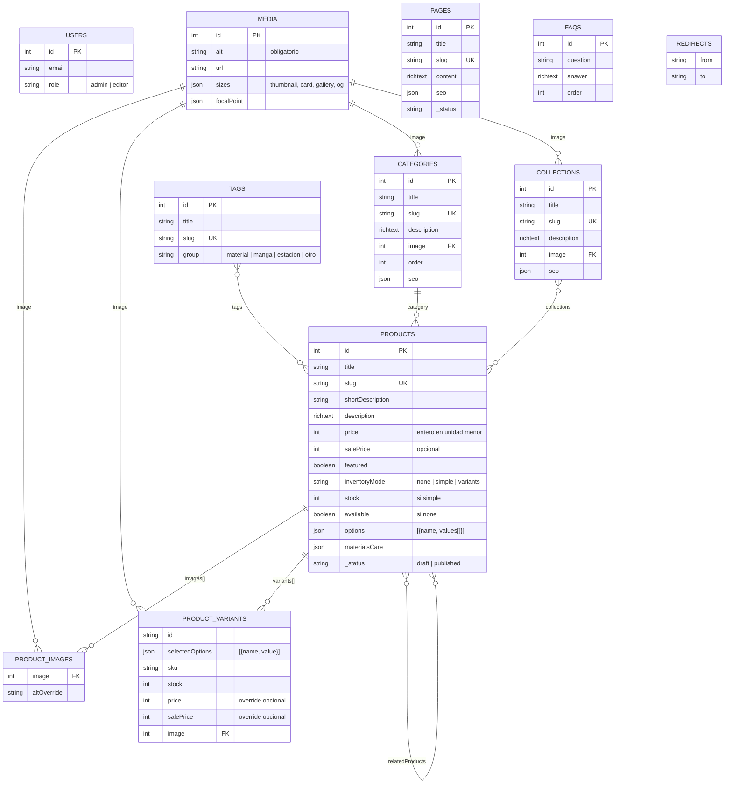

# Modelo de datos

Implementado como colecciones y globals de Payload CMS. Los nombres de slug de colección están en inglés (convención de código); las etiquetas visibles en el panel están en español.

## 1. Diagrama de relaciones

Globals (un único documento cada uno): `site-settings`, `navigation`, `home-page`, `size-guide`.

## 2. Colecciones

### 2.1 `users` (Usuarios)

| Campo | Tipo | Reglas |
| --- | --- | --- |
| email, password | auth de Payload | Cookie HTTP-only, bloqueo tras 5 intentos fallidos, 10 min |
| name | text | Obligatorio |
| role | select `admin` \| `editor` | Solo un admin puede cambiar roles; el primer usuario se crea como admin |

### 2.2 `media` (Imágenes)

| Campo | Tipo | Reglas |
| --- | --- | --- |
| alt | text | **Obligatorio**; descripción útil para accesibilidad y SEO |
| caption | text | Opcional |
| upload | — | Solo `image/jpeg`, `image/png`, `image/webp`, `image/avif`; máximo 8 MB; `focalPoint: true`; tamaños generados: `thumbnail` 300, `card` 640, `gallery` 1200, `og` 1200×630 recortado |

### 2.3 `categories` (Categorías)

title, slug (autogenerado desde title, editable, único), description (richText corto), image (media), order (number, orden manual en menús y filtros), seo (grupo del plugin SEO). Sin jerarquía padre/hijo (ADR-007 explica por qué se mantiene plano; las agrupaciones curadas usan colecciones).

### 2.4 `collections` (Colecciones)

Igual que categorías, sin `order`. Un producto puede pertenecer a varias colecciones.

### 2.5 `tags` (Etiquetas)

title, slug, group (select: material, manga, estación, otro). Se usan en filtros del catálogo y en la ficha de producto.

### 2.6 `products` (Productos)

Pestañas en el panel: **Información**, **Precio y existencias**, **Imágenes**, **Detalles**, **SEO**.

| Campo | Tipo | Reglas / notas |
| --- | --- | --- |
| title | text | Obligatorio |
| slug | text | Único, autogenerado, editable; aviso de redirección si cambia estando publicado |
| shortDescription | textarea | ≤ 160 caracteres; se usa en tarjetas y como fallback de metadescripción |
| description | richText (Lexical) | Encabezados h2/h3, listas, negritas, enlaces |
| category | relationship → categories | Obligatoria, una sola |
| collections | relationship → collections, hasMany | Opcional |
| tags | relationship → tags, hasMany | Opcional |
| price | number (entero, unidad menor de la moneda) | ≥ 0. Se almacena como entero para evitar errores de coma flotante; la moneda vive en `site-settings` |
| salePrice | number | Opcional; si existe debe ser < price |
| inventoryMode | select `none` \| `simple` \| `variants` | `none`: solo bandera `available`; `simple`: `stock` numérico; `variants`: existencias por variante |
| available | checkbox | Visible si `inventoryMode = none` |
| stock | number ≥ 0 | Visible si `inventoryMode = simple` |
| options | array `{ name, values: array<{ value }> }` | Visible si `variants`; p. ej. Talla: S, M, L; Color: Rosa, Gris |
| variants | array | Visible si `variants`. Campos: `selectedOptions` (array `{ name, value }`), `sku`, `stock` ≥ 0, `price` y `salePrice` opcionales (override), `image` (media). Validación: combinación única y coherente con `options` |
| images | array `{ image: media (obligatorio), altOverride }` | Mínimo 1 para publicar; el primero es la imagen principal; reordenable por arrastre |
| materialsCare | group `{ materials: text, care: richText }` | Opcional |
| featured | checkbox | Aparece en inicio si el bloque de destacados está en modo automático |
| relatedProducts | relationship → products, hasMany, máx 4 | Opcional |
| seo | grupo plugin SEO | title, description, image |
| publishedAt | date | Autocompletado al publicar; ordena "novedades" |
| _status | drafts de Payload | `draft` / `published`; autosave cada 2 s en borrador |

Campos derivados en tiempo de lectura (no almacenados): `effectivePrice`, `isOnSale`, `availability` (`in_stock` \| `low_stock` \| `out_of_stock`), `priceRange` para productos con variantes de precio distinto.

### 2.7 `pages` (Páginas)

title, slug, content (richText con bloques: texto, imagen, lista de preguntas frecuentes, bloque de contacto), seo, drafts. Slugs reservados por la app (no se pueden usar): `productos`, `categorias`, `colecciones`, `carrito`, `finalizar-pedido`, `buscar`, `admin`, `api`.

### 2.8 `faqs` (Preguntas frecuentes)

question (text), answer (richText), order (number). Se renderizan en `/preguntas-frecuentes` y pueden incrustarse en páginas y en la ficha de producto (bloque opcional).

### 2.9 `redirects` (Redirecciones)

Plugin `@payloadcms/plugin-redirects`: `from` (ruta), `to` (ruta interna o URL). Se consulta en `proxy.ts` con caché.

## 3. Globals

### 3.1 `site-settings` (Configuración del sitio)

| Grupo | Campos |
| --- | --- |
| Marca | siteName, tagline, logo (media), favicon (media) |
| Comercio | currency (ISO 4217, por defecto `COP`), locale (`es-CO`), lowStockThreshold (por defecto 3), shippingNotice (texto corto en ficha), availabilityNotice |
| WhatsApp | enabled, phoneNumber (solo dígitos con indicativo, validado), greeting (plantilla con `{{nombre}}`), floatingButton (checkbox), floatingButtonMessage |
| Contacto | email, phone, address, schedule, socialLinks array `{ platform, url }` |
| Anuncio | announcementEnabled, announcementText, announcementLink |
| Confianza | trustItems array `{ icon, title, text }` (máx 4) |
| SEO | defaultTitleSuffix, defaultDescription, defaultOgImage, organizationSameAs (URLs de redes para `Organization`) |

### 3.2 `navigation` (Navegación)

header: array `{ label, type: internal|external, reference (categoría/colección/página), url, highlight }`; footerColumns: array `{ title, links[] }`; legalLinks: array; footerText.

### 3.3 `home-page` (Página de inicio)

hero: array de slides `{ image, imageMobile, eyebrow, title, text, ctaLabel, ctaLink, align }`; featuredCategories: relationship hasMany; featuredProductsMode (`manual` \| `featuredFlag` \| `collection`), featuredProducts, featuredCollection, featuredTitle; promoBlock `{ enabled, image, title, text, ctaLabel, ctaLink }`; showTrustBlock. Drafts + live preview.

### 3.4 `size-guide` (Guía de tallas)

content (richText, tabla de medidas), note. Se muestra en un panel lateral desde la ficha de producto.

## 4. Reglas de negocio centralizadas en `@pijamas/domain`

- `getEffectivePrice(product, variant?)`: precio vigente considerando overrides y promoción.
- `getAvailability(product, variant?, threshold)`: estado de disponibilidad.
- `computeCartTotals(lines)`: subtotal por línea, total, número de unidades.
- `buildWhatsAppMessage(order, settings)`: texto legible del pedido.
- `buildWhatsAppUrl(phone, message)`: `https://wa.me/<digits>?text=<encodeURIComponent>`.
- `normalizeWhatsAppPhone(input)`: elimina `+`, espacios, guiones, paréntesis; valida 8–15 dígitos (E.164).
- `formatPrice(minorUnits, currency, locale)`: `Intl.NumberFormat`.
- Esquemas Zod: `cartLineSchema`, `checkoutFormSchema`, `whatsAppPhoneSchema`.

## 5. Índices y consultas

Payload crea índices para `slug` (unique) y relaciones. Consultas típicas del catálogo:

- Listado: `where: { _status: { equals: 'published' } }`, `sort: '-publishedAt'`, `limit: 24`, `depth: 1`, `select` restringido a campos de tarjeta.
- Filtro por talla/color: `where: { 'variants.selectedOptions.value': { in: [...] } }` combinado con `inventoryMode`.
- Rango de precio: `price` o `salePrice` entre límites (se filtra sobre `price` y se refina en memoria por `effectivePrice`; con ≤ 200 productos el costo es despreciable).

## 6. Semillas (`pnpm --filter web seed`)

Crea: usuario admin desde variables de entorno (`SEED_ADMIN_EMAIL`, `SEED_ADMIN_PASSWORD`), 4 categorías, 2 colecciones, 6 etiquetas, 12 productos con variantes e imágenes de ejemplo libres de derechos (placeholders generados localmente), páginas institucionales con texto de ejemplo, 6 preguntas frecuentes, globals con valores de demostración y número de WhatsApp de prueba. Idempotente: no duplica si ya existe el slug.
