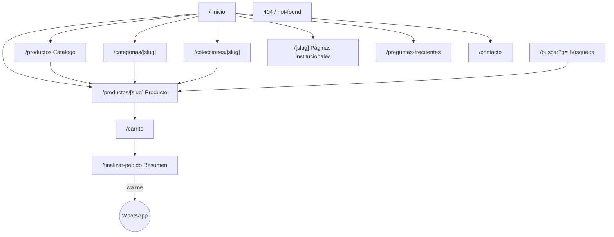

# Mapa de navegación y definición de pantallas

## 1. Mapa del sitio público



Rutas técnicas: `/admin` (Payload), `/api/*` (REST de Payload, solo para el panel), `/next/preview` y `/next/exit-preview` (vista previa), `/next/revalidate` (revalidación bajo demanda protegida), `/sitemap.xml`, `/robots.txt`, `/opengraph-image` por ruta.

## 2. Estructura de rutas en `apps/web/src/app`

```
app/
├── (frontend)/
│   ├── layout.tsx                 # Header, footer, barra de anuncio, botón WhatsApp, fuentes
│   ├── page.tsx                   # Inicio
│   ├── productos/
│   │   ├── page.tsx               # Catálogo con filtros (searchParams)
│   │   └── [slug]/page.tsx        # Producto
│   ├── categorias/[slug]/page.tsx
│   ├── colecciones/[slug]/page.tsx
│   ├── buscar/page.tsx
│   ├── carrito/page.tsx
│   ├── finalizar-pedido/page.tsx
│   ├── preguntas-frecuentes/page.tsx
│   ├── contacto/page.tsx
│   ├── [slug]/page.tsx            # Páginas institucionales (Pages)
│   ├── not-found.tsx
│   ├── error.tsx
│   ├── sitemap.ts
│   └── robots.ts
├── (payload)/                     # Generado por create-payload-app
│   ├── admin/[[...segments]]/
│   ├── api/[...slug]/
│   └── layout.tsx
└── next/
    ├── preview/route.ts
    ├── exit-preview/route.ts
    └── revalidate/route.ts
```

## 3. Definición de pantallas

### 3.1 Inicio

Objetivo: comunicar propuesta de valor y llevar al catálogo en un clic.

Secciones (orden administrable solo en contenido, no en estructura):

1. Barra de anuncio (opcional).
2. Cabecera: logotipo, menú principal, búsqueda, carrito con contador.
3. Hero: 1–3 slides con imagen (desktop y móvil), eyebrow, título h1, texto, CTA. Sin autoplay si `prefers-reduced-motion`; autoplay máximo 6 s. El cursor sobre la foto no detiene el cambio (si lo hiciera, la portada se vería fija). Los puntos siguen permitiendo elegir una foto.
4. Categorías destacadas: tarjetas con imagen y nombre (3–4).
5. Productos destacados: carrusel/grid de 4–8 tarjetas de producto.
6. Bloque promocional: imagen + texto + CTA.
7. Bloque de confianza: 3–4 ítems con icono.
8. Pie: columnas de enlaces, redes, datos de contacto, legales.

Estados: sin productos destacados → se oculta la sección; sin hero → cabecera compacta con título.

### 3.2 Catálogo / Categoría / Colección

Layout: título h1 + descripción (indexable), barra de resultados y orden, filtros en columna lateral (desktop) o panel deslizable (móvil), grid de tarjetas 2 columnas (móvil), 3 (tablet), 4 (desktop), paginación numerada (`?page=`).

Filtros (parámetros de URL): `categoria`, `talla`, `color`, `precio_min`, `precio_max`, `disponible`, `orden`. Las URLs con filtros llevan `rel="canonical"` a la página sin filtros y `noindex` (ver `docs/seo.md`).

Tarjeta de producto: imagen principal (ratio 4:5) con segunda imagen al hover si existe, nombre, precio (y tachado si promoción), etiqueta "Oferta"/"Nuevo"/"Agotado", colores disponibles como puntos (máx 5).

Estados: cargando (skeletons), sin resultados (ilustración + botón "Quitar filtros"), error (mensaje y reintento).

### 3.3 Producto

- Migas de pan: Inicio › Categoría › Producto.
- Galería: miniaturas verticales (desktop) / carrusel con puntos (móvil); zoom al tocar; imagen principal con `priority`.
- Panel de compra (sticky en desktop): nombre h1, precio con promoción, estado de disponibilidad, selector de opciones (botones de talla; muestras de color con nombre), combinaciones agotadas deshabilitadas con estado visible, selector de cantidad, botón "Agregar al carrito", enlace "Consultar por WhatsApp" (prellenado con el producto), aviso de envío configurable, botón "Guía de tallas" (panel lateral).
- Descripción (richText), materiales y cuidados (acordeón), preguntas frecuentes del producto (opcional).
- Productos relacionados (4 tarjetas).
- Al agregar: toast con confirmación y acceso al carrito; el contador de la cabecera se actualiza.

### 3.4 Carrito (`/carrito`) y mini-carrito

- Mini-carrito: panel lateral (Sheet) al agregar o al pulsar el icono; líneas con imagen, nombre, variante, cantidad editable, subtotal; total; botón "Finalizar pedido".
- Página `/carrito`: misma lista en formato amplio; aviso si algún producto cambió de precio o se agotó (revalidación con el servidor al cargar); carrito vacío → ilustración + CTA al catálogo.

### 3.5 Finalizar pedido (`/finalizar-pedido`)

- Formulario: nombre (obligatorio), ciudad/zona (opcional), nota (opcional). Validación Zod cliente y servidor (Server Action que reconfirma precios y devuelve el mensaje y la URL).
- Resumen de líneas y total estimado.
- Texto explicativo: "Al continuar se abrirá WhatsApp con tu pedido listo para enviar. La disponibilidad y el total se confirman en la conversación."
- Botón "Enviar pedido por WhatsApp" → abre `wa.me` en nueva pestaña (`rel="noopener"`).
- Tras el clic: estado "Pedido preparado" con opción "Vaciar carrito" o "Seguir comprando". Sin lenguaje de confirmación.
- Si WhatsApp está desactivado en el panel: se muestra contacto alternativo (correo/teléfono).

### 3.6 Páginas institucionales, FAQ y contacto

- Contenido richText con tipografía editorial, ancho máximo 72 caracteres por línea.
- FAQ: acordeón accesible (`<details>`/botones con `aria-expanded`), datos estructurados `FAQPage` solo si la página es exclusivamente de preguntas frecuentes.
- Contacto: datos del global (correo, teléfono, dirección, horario), botón de WhatsApp, mapa opcional como enlace externo (no iframe por rendimiento).

### 3.7 Error y vacío

- `not-found.tsx`: mensaje amable, buscador, enlaces a categorías.
- `error.tsx`: mensaje genérico y botón de reintento; el detalle se registra en servidor.

## 4. Panel administrativo (`/admin`)

Navegación generada por Payload con grupos personalizados:

- **Catálogo**: Productos, Categorías, Colecciones, Etiquetas.
- **Contenido**: Página de inicio, Páginas, Preguntas frecuentes, Guía de tallas.
- **Sitio**: Configuración del sitio, Navegación, Redirecciones.
- **Sistema**: Imágenes, Usuarios (solo admin).

Flujo de edición de producto: crear borrador → completar pestañas → "Vista previa" (live preview en `/productos/[slug]?draft=1`) → "Publicar". Los cambios se reflejan en la tienda en segundos por revalidación por etiquetas.
